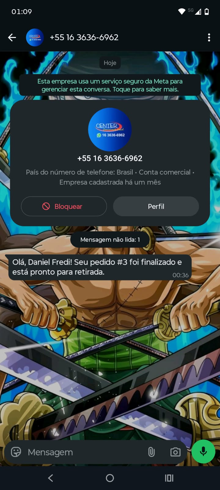

# E9 — Evidências da Avaliação e do Aceite

**Equipe:** Breno Tales de Oliveira Leite (RA: 2840482423029) — Daniel Fredi Soares Pereira (RA: 2840482421054) 
**Data do registro:** 15/11/2026 
**Cliente Real / Homologador:** Paulo Rogério Leite (Proprietário — Center Comunicação Visual) 
**Product Owner da Equipe:** Breno Tales de Oliveira Leite

## 1. Registros da avaliação

Registramos o aceite formal do escopo pelo cliente real da empresa parceira (Paulo Rogério Leite) e a confirmação de que o webhook está configurado e as mensagens do WhatsApp estão chegando aos clientes. Essas informações foram homologadas durante a preparação da entrega E9.

Anexamos a captura do recebimento da notificação do pedido #3 no WhatsApp. O aceite foi formalizado e assinado digitalmente via Gov.br pelo cliente homologador e pela equipe de desenvolvimento, disponível em [E9-termo-de-aceite-cliente_assinado.pdf](E9-termo-de-aceite-cliente_assinado.pdf). O recebimento real é uma evidência manual e não foi contabilizado como novo teste automatizado.

## 2. Evidências disponíveis

| Evidência | Referência | O que comprova |
|---|---|---|
| Bateria final: 115 testes aprovados | [Relatório final, seções 1 e 2](relatorio-testes-final.md) | Resultado da execução automatizada, com extrato do runner |
| Testes consolidados da Sprint 4 | [Evidências E8](sprints/sprint-4-evidencias-teste.md) | Histórico da validação automatizada do MVP |
| Testes da integração WhatsApp | [Evidências Sprint 3](sprints/sprint-3-evidencias-teste.md) | Cenários automatizados de envio, falha e persistência com mocks |
| Aceite do escopo pelo cliente real | [E9-termo-de-aceite-cliente_assinado.pdf](E9-termo-de-aceite-cliente_assinado.pdf) e [Termo de Aceite](E9-termo-de-aceite-cliente.md) | Homologação com assinaturas digitais Gov.br do cliente real e equipe |
| Recebimento real pelo WhatsApp — AM05 | [whatsapp-pedido-3.png](screenshots/whatsapp-pedido-3.png) | Notificação do pedido #3 recebida no WhatsApp, com horário 00:36 |
| Tela de clientes | [clientes.png](screenshots/clientes.png) | Interface documentada no projeto |
| Tela de estoque | [estoque.png](screenshots/Estoque-adm.png) | Interface documentada no projeto |
| Cadastro de pedido | [novo-pedido.png](screenshots/Novo%20pedido.png) | Interface documentada no projeto |
| Listagem de pedidos | [pedidos.png](screenshots/pedidos.png) | Interface documentada no projeto |

## 3. Recebimento da notificação no WhatsApp — AM05

A captura mostra a mensagem recebida:

Olá, Daniel Fredi! Seu pedido #3 foi finalizado e está pronto para retirada.

**Resultado observado:** notificação referente ao pedido #3 recebida no aplicativo WhatsApp do destinatário(Daniel).

A captura comprova o recebimento dessa mensagem. A configuração do webhook foi confirmada separadamente na avaliação; a imagem não demonstra o processamento de seus eventos nem o mecanismo de disparo automático. Falhas e repetição de status foram verificadas na suíte com mocks.
