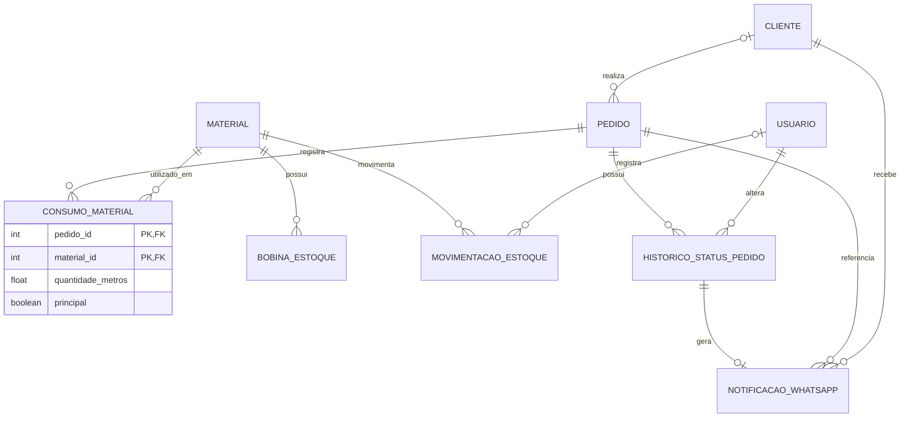

# DER — Modelo implementado do Sistema de Pedidos e Controle de Estoque

**Equipe:** Breno Tales de Oliveira Leite (RA: 2840482423029) — Daniel Fredi Soares Pereira (RA: 2840482421054) 
**Atualização:** 15/11/2026 — relação Pedido ↔ Material implementada na E10.

## 1. Relacionamentos

**Pedido ↔ Material é N:N:** um pedido pode consumir vários materiais e um material pode participar de vários pedidos. Cada associação tem sua quantidade em metros. Cliente ↔ Pedido continua 1:N; pedidos legados podem ter cliente não vinculado.

## 2. Tabela associativa consumo_material

| Campo | Tipo | Restrição / uso |
|---|---|---|
| pedido_id | INTEGER | PK composta; FK para pedido.id |
| material_id | INTEGER | PK composta; FK para material.id |
| quantidade_metros | FLOAT | NOT NULL e CHECK > 0; consumo total do material no pedido |
| principal | BOOLEAN | NOT NULL; identifica o material calculado pelo corte |

A chave composta impede repetir um material no mesmo pedido. A aplicação exige quantidades finitas, positivas, arredondadas a duas casas e estoque suficiente. Cada pedido criado pelo formulário tem um material principal e pode ter materiais adicionais.

A edição estorna todos os consumos anteriores e aplica os novos. O cancelamento permitido estorna todos e remove as associações. Pedido, consumos, estoque e movimentações são gravados na mesma transação. Material associado não pode ser excluído.

## 3. Outros modelos

| Modelo | Dados principais |
|---|---|
| Usuario | ID, nome, e-mail, senha com hash e perfil admin/funcionario |
| Cliente | ID, nome, telefone e empresa |
| Pedido | Cliente, dados históricos do material principal, medidas, corte, quantidade, área, status e criação |
| CategoriaMaterial | Tipos de materiais cadastrados |
| Material | Categoria, nome, largura, código único e estoque mínimo |
| BobinaEstoque | Material e metros restantes |
| MovimentacaoEstoque | Material, usuário, tipo, metros, bobinas, motivo e data |
| HistoricoStatusPedido | Pedido, usuário, status anterior/novo e data |
| NotificacaoWhatsApp | Transição única, pedido, cliente, resultado, identificador e erro |

As definições completas estão em [models/](../models/) e o DDL SQLite atual em [schema.sql](../database/schema.sql). O [DER E3](E3-der.md) preserva o modelo conceitual original, que também previa entidades não implementadas como Perfil e ItemPedido.

## 4. Migração dos pedidos existentes

Na inicialização, a aplicação cria a tabela associativa e executa uma migração identificada por pedido_consumo_material_v1. A associação é feita somente quando categoria, nome e largura identificam um material e a metragem é válida. A migração preserva IDs, saldos e movimentações; não baixa o estoque novamente.

Pedidos sem material identificável permanecem consultáveis, sem associação inventada. A edição e o cancelamento desses pedidos ficam bloqueados até regularização do vínculo. A migração é executada uma vez, e reinícios não duplicam o consumo.

Faça backup do SQLite antes de iniciar a nova versão sobre um banco existente. A implementação foi testada em banco isolado; o deploy desta alteração não foi realizado nesta entrega.
