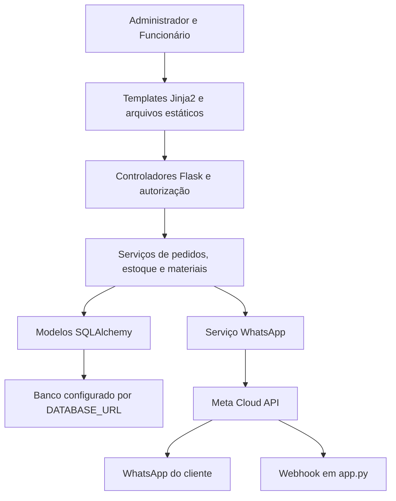

# Documentação Final — Sistema Web de Controle de Estoque para Empresa de Comunicação Visual

**Entrega:** E10 — Documentação Final Consolidada 
**Equipe:** Breno Tales de Oliveira Leite (RA: 2840482423029) — Daniel Fredi Soares Pereira (RA: 2840482421054) · Laboratório de Engenharia de Software · ADS Fatec Ribeirão Preto 
**Data da consolidação:** 15/11/2026 
**Prazo:** 20/11/2026, às 23h59 — envio online 
**Deploy definitivo:** https://center-pedidos.onrender.com 
**Repositório:** https://github.com/brenotales1/sistema-pedidos

## 1. Índice de artefatos do semestre

| Entrega | Documento | Link |
|---|---|---|
| E1 | Documento de Visão | [E1-documento-de-visao.md](E1-documento-de-visao.md) |
| E1 | Declaração de Escopo | [E1-declaracao-de-escopo.md](E1-declaracao-de-escopo.md) |
| E2 | Backlog original e backlog atualizado | [E2-backlog-priorizado.md](E2-backlog-priorizado.md) · [backlog.md](backlog.md) |
| E2b | Termo de Aceite do Projeto | [E2-termo-de-aceite.md](E2-termo-de-aceite.md) |
| E3 | UML, DER e DDL de referência | [UML](E3-uml.md) · [DER](E3-der.md) · [DDL](E3-schema.sql) |
| E4 | README, protótipo e plano originais | [README E4](E4-README.md) · [protótipo](E4-prototipo.md) · [plano E4b](E4-plano-de-testes.md) |
| E4 — atualização | Plano consolidado de testes | [plano-de-testes.md](plano-de-testes.md) |
| E5 | Sprint 1 | [relatório](sprints/sprint-1-relatorio.md) · [testes](sprints/sprint-1-evidencias-teste.md) · [retrospectiva](sprints/sprint-1-retrospectiva.md) |
| E6 | Sprint 2 | [relatório](sprints/sprint-2-relatorio.md) · [testes](sprints/sprint-2-evidencias-teste.md) · [retrospectiva](sprints/sprint-2-retrospectiva.md) |
| E7 | Sprint 3 | [relatório](sprints/sprint-3-relatorio.md) · [testes](sprints/sprint-3-evidencias-teste.md) · [retrospectiva](sprints/sprint-3-retrospectiva.md) |
| E8 | Sprint 4 | [relatório](sprints/sprint-4-relatorio.md) · [testes](sprints/sprint-4-evidencias-teste.md) · [retrospectiva](sprints/sprint-4-retrospectiva.md) · [revisão do MVP](sprints/sprint-4-revisao-mvp.md) |
| E9 | Relatório final de testes | [relatorio-testes-final.md](relatorio-testes-final.md) |
| E9b | Termo de Aceite do Cliente | [E9-termo-de-aceite-cliente.md](E9-termo-de-aceite-cliente.md) |
| E9 — anexos | Índice e evidências de aceitação | [README E9](E9-README.md) · [evidências](E9-evidencias-aceitacao.md) |
| E10 | README final, documentação e manual | [README final](../README.md) · [documentação final](documentacao-final.md) · [manual do usuário](manual-do-usuario.md) · [situação da E10](E10-README.md) |

### Contribuições individuais

| Sprint | Breno Tales de Oliveira Leite | Daniel Fredi Soares Pereira |
|---|---|---|
| 1 | [contribuição](sprints/sprint-1-contribuicao-breno.md) | [contribuição](sprints/sprint-1-contribuicao-daniel.md) |
| 2 | [contribuição](sprints/sprint-2-contribuicao-breno.md) | [contribuição](sprints/sprint-2-contribuicao-daniel.md) |
| 3 | [contribuição](sprints/sprint-3-contribuicao-breno.md) | [contribuição](sprints/sprint-3-contribuicao-daniel.md) |
| 4 | [contribuição](sprints/sprint-4-contribuicao-breno.md) | [contribuição](sprints/sprint-4-contribuicao-daniel.md) |

## 2. Desvios do escopo original (vs. E2b)

Os 11 itens foram registrados como entregues e aceitos na E9b. As diferenças de implementação e os limites das evidências estão descritos abaixo.

| Item da E2b | Mudou? | Implementação final / justificativa |
|---|---|---|
| 1. Autenticação e perfis | Escopo mantido | Permissões por valor admin/funcionario em Usuario.perfil; não existe entidade Perfil separada no código atual |
| 2. Cadastro com código de barras | Escopo mantido | Código único; regularização de materiais antigos sem perder saldo e histórico |
| 3. Consulta de materiais | Escopo mantido | Busca por material ou código, agrupamento e consulta de saldo |
| 4. Identificação por código | Escopo mantido | Identificação autenticada sem movimentar estoque |
| 5. Entrada por código | Escopo mantido | Quantidade em bobinas, cada uma com 50 m; evidência automatizada disponível, sem registro de leitor físico |
| 6. Histórico de movimentações | Detalhado na execução | Entradas, saídas, ajustes, consumo e estorno com registro de usuário e motivo |
| 7. Andamento dos pedidos | Escopo mantido | Quatro status finais definidos no código; transições auditadas |
| 8. Notificações pelo WhatsApp | Implementação definida | Meta Cloud API com template; envio associado à atualização do pedido, sem ação independente de envio manual |
| 9. Notificações por eventos | Evento definido | Transição para Pronto para retirada dispara tentativa; repetição de status não reenvia; Finalizado é outro status |
| 10. Histórico de notificações | Escopo mantido | Consulta exclusiva do administrador, paginação de 25 registros e filtros; aceite da API não equivale a entrega confirmada |
| 11. Estoque mínimo | Regra detalhada | Limite em metros, alerta somente quando saldo < mínimo e filtro de reposição |
| Deploy, inicialmente a definir | Definido | URL pública no Render informada para esta consolidação |
| Modelo conceitual E3 | N:N implementada na E10 | ConsumoMaterial associa Pedido e Material com quantidade em metros; os dados antigos do principal foram preservados. Perfil e ItemPedido continuam conceitos não implementados como tabelas separadas |

A relação N:N Pedido–Material foi implementada por ConsumoMaterial na E10 e validada com dois pedidos compartilhando dois materiais. Os diagramas históricos da E3 foram preservados. O [DER final](der.md), a [UML final](uml.md) e o [DDL implementado](../database/schema.sql) descrevem a versão atual. A [validação N:N](E10-validacao-nn.md) registra migração, integridade e regressão. Essa mudança é posterior ao aceite histórico da E9 e ainda não foi publicada no Render.

O banco de dados do projeto é SQLite. Conforme informado pelo responsável, o banco local não foi migrado para o Render. As opções de configuração estão no README.

## 3. Arquitetura final

A aplicação usa Flask com páginas renderizadas no servidor. Os controladores recebem as operações das telas, verificam sessão/perfil e chamam serviços de negócio. SQLAlchemy persiste os modelos no banco configurado. O envio de WhatsApp ocorre após a gravação da transição do pedido, preservando essa atualização caso o envio falhe.

### Modelo implementado

- Usuario: autenticação e perfil.
- Cliente: dados de contato e associação aos pedidos.
- Pedido: cliente, medidas, quantidade, dados do material principal, cálculo, status e coleção de consumos.
- ConsumoMaterial: associação N:N entre pedido e material com consumo em metros e indicação de principal.
- CategoriaMaterial, Material e BobinaEstoque: organização e saldo físico.
- MovimentacaoEstoque: material, responsável, quantidade, tipo e motivo.
- HistoricoStatusPedido: transições com pedido e responsável.
- NotificacaoWhatsApp: tentativa vinculada à transição, ao pedido e ao cliente.

As definições finais estão em [models/](../models/) e as alterações de estrutura em [database_migration_service.py](../services/database_migration_service.py). O DDL da E3 é histórico; a aplicação usa os modelos e as migrações para preparar o banco.

O webhook atual valida a inscrição e recebe eventos, mas não atualiza entrega_confirmada. A [captura da E9](screenshots/whatsapp-pedido-3.png) comprova o recebimento de uma mensagem pelo destinatário, sem demonstrar esse processamento no banco.

## 4. Como contribuir e rodar

Consulte o [README final](../README.md) para instalação, configuração, inicialização, testes, produção e contribuição. O [manual do usuário](manual-do-usuario.md) apresenta as operações por perfil.

## 5. Rastreabilidade requisito → modelo → código → teste

Os IDs correspondem ao [plano atualizado](plano-de-testes.md). A [E9](relatorio-testes-final.md) consolida a execução dos testes; os links de código apontam para a implementação final, complementando os modelos históricos da E3.

| E2b / requisito | Modelo final | Código principal | Testes / cenários |
|---|---|---|---|
| 1. Login e perfis | [Usuario](../models/usuario.py) | [auth_controller](../controllers/auth_controller.py), [autorização](../controllers/auth_required.py) | [test_auth](../tests/test_auth.py): CT01–CT02, CT08–CT14 |
| 2. Cadastro com código | [Material](../models/material.py), [BobinaEstoque](../models/bobina_estoque.py) | [estoque_controller](../controllers/estoque_controller.py), [material_service](../services/material_service.py) | [test_estoque](../tests/test_estoque.py), [regularização](../tests/test_codigo_barras_materiais.py): CT03, CT20–CT21, CT52–CT53 |
| 3. Consulta de materiais | [Material](../models/material.py) | [estoque_controller](../controllers/estoque_controller.py) | [test_estoque](../tests/test_estoque.py): CT04, CT22 |
| 4. Identificação por código | [Material](../models/material.py) | [material_service](../services/material_service.py), [estoque_controller](../controllers/estoque_controller.py) | [test_estoque](../tests/test_estoque.py): CT06, CT23–CT25 |
| 5. Entrada de materiais | [BobinaEstoque](../models/bobina_estoque.py), [MovimentacaoEstoque](../models/movimentacao_estoque.py) | [estoque_service](../services/estoque_service.py), [estoque_controller](../controllers/estoque_controller.py) | [test_estoque](../tests/test_estoque.py): CT05, CT07, CT26–CT29; [movimentações](../tests/test_movimentacoes_sprint4.py): CT48 |
| 6. Histórico de movimentações | [MovimentacaoEstoque](../models/movimentacao_estoque.py) | [estoque_controller](../controllers/estoque_controller.py), [estoque_service](../services/estoque_service.py), [pedido_controller](../controllers/pedido_controller.py) | [test_estoque](../tests/test_estoque.py): CT30–CT33; [movimentações](../tests/test_movimentacoes_sprint4.py): CT47–CT49 |
| 7. Andamento dos pedidos | [Pedido](../models/pedido.py), [HistoricoStatusPedido](../models/historico_status_pedido.py) | [pedido_controller](../controllers/pedido_controller.py), [pedido_service](../services/pedido_service.py) | [test_pedidos](../tests/test_pedidos.py): CT40; [persistência](../tests/test_notificacao_persistencia.py): CT45 |
| 8. WhatsApp | [Cliente](../models/cliente.py), [NotificacaoWhatsApp](../models/notificacao_whatsapp.py) | [whatsapp_service](../services/whatsapp_service.py) | [test_whatsapp](../tests/test_whatsapp.py), [feedback](../tests/test_notificacao_visual.py): CT42–CT44; [captura real](screenshots/whatsapp-pedido-3.png) |
| 9. Envio automático | [HistoricoStatusPedido](../models/historico_status_pedido.py), [NotificacaoWhatsApp](../models/notificacao_whatsapp.py) | [pedido_service](../services/pedido_service.py) | [persistência](../tests/test_notificacao_persistencia.py): CT43, CT45 |
| 10. Histórico de notificações | [NotificacaoWhatsApp](../models/notificacao_whatsapp.py) | [notificacao_controller](../controllers/notificacao_controller.py) | [histórico](../tests/test_notificacoes_historico.py): CT46 |
| 11. Estoque mínimo | [Material](../models/material.py) | [estoque_controller](../controllers/estoque_controller.py), [migrações](../services/database_migration_service.py) | [estoque mínimo](../tests/test_estoque_minimo.py): CT50 |
| Relação N:N Pedido–Material | [ConsumoMaterial](../models/consumo_material.py) | [serviço de consumo e migração](../services/consumo_material_service.py), [controlador](../controllers/pedido_controller.py), [formulário](../templates/pedidos/_materiais_adicionais.html) | [16 testes N:N](../tests/test_consumo_material.py), CT56–CT59; [evidência](E10-validacao-nn.md) |

Clientes, migrações, corte, cancelamento e inicialização também possuem testes complementares, descritos na E9. A E9 registrou 115 testes aprovados. A regressão atual da E10, após o N:N, tem 131 testes aprovados; cobertura percentual de linhas e branches não foi mensurada.

## 6. Fechamento documental

O escopo funcional foi aceito sem ressalvas na E9b, com formalização por assinatura ou e-mail ainda pendente. As capturas atuais fornecidas foram incluídas no manual, cobrindo os dois perfis. O manual também inclui a [captura do alerta de estoque baixo](screenshots/abaixo-min.png), com saldo de 50 m e mínimo de 100 m. O recorte mostra o alerta; não exibe o estado do filtro. Todas as capturas das telas foram feitas no ambiente de produção, em https://center-pedidos.onrender.com. Consulte a lista em [E10-README.md](E10-README.md).
