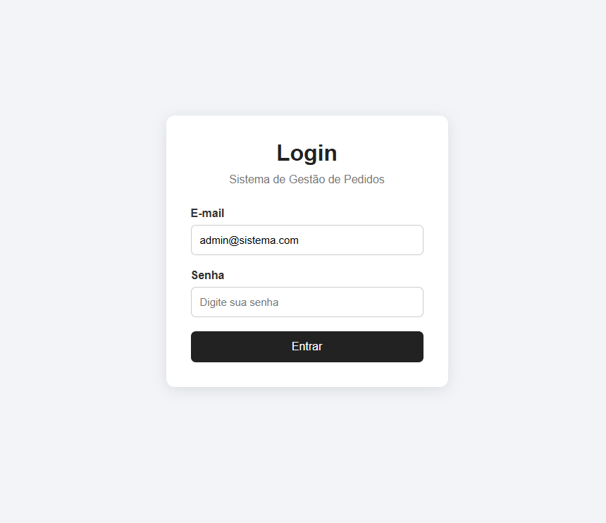
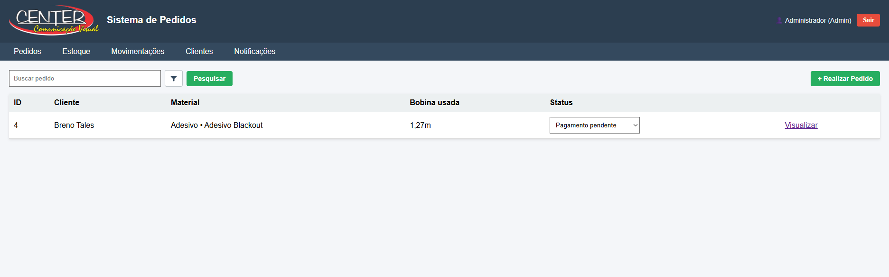
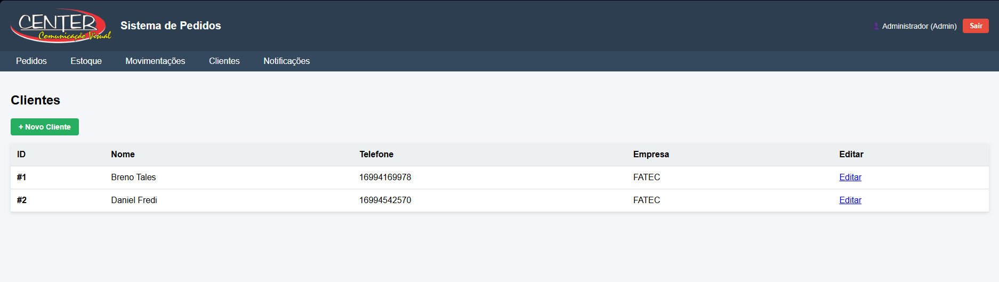
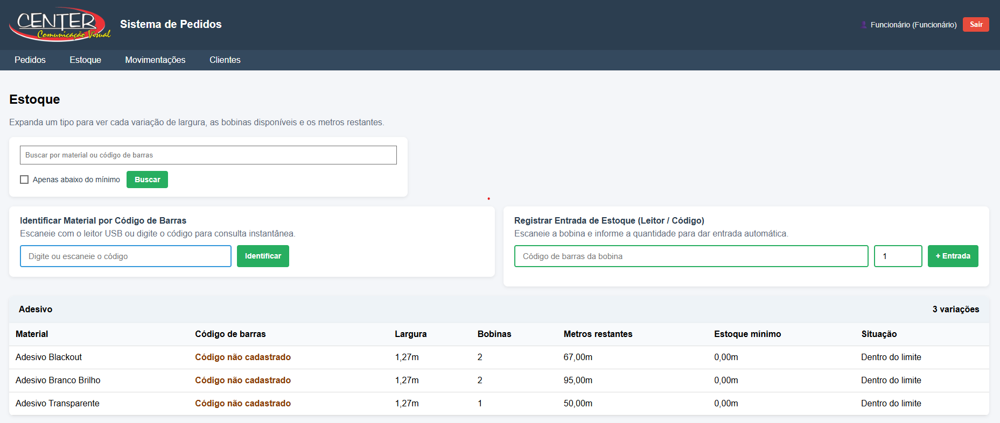
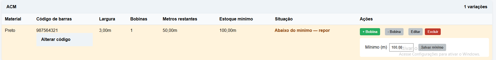
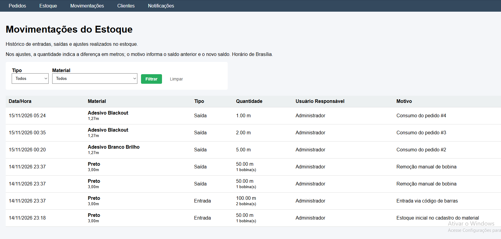
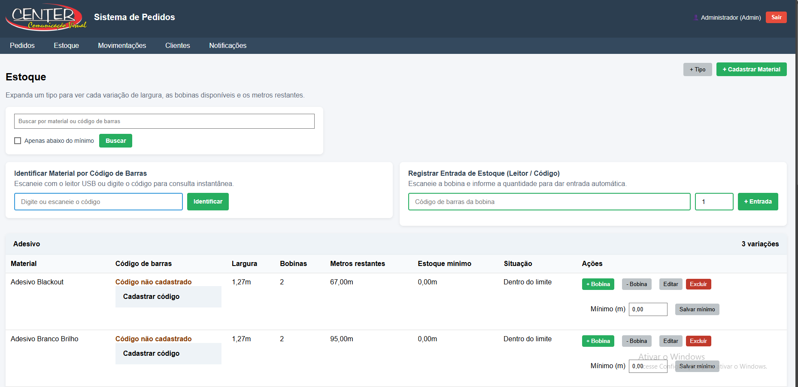
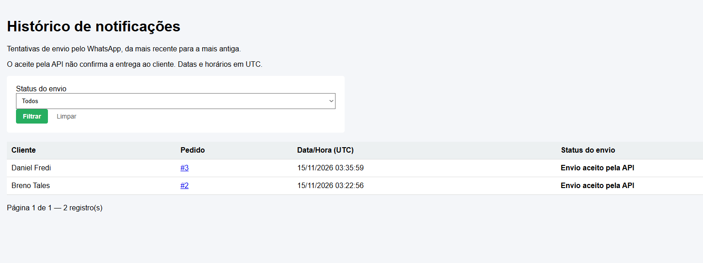

# Manual do Usuário — Sistema Web de Controle de Estoque para Empresa de Comunicação Visual

**Entrega:** E10 — Manual do Usuário 
**Equipe:** Breno Tales de Oliveira Leite (RA: 2840482423029) — Daniel Fredi Soares Pereira (RA: 2840482421054) 
**Data:** 15/11/2026 
**Acesso:** https://center-pedidos.onrender.com

O sistema reúne clientes, pedidos, materiais e avisos pelo WhatsApp. As opções disponíveis dependem do perfil da sua conta.

**Sobre as imagens:** as capturas das telas foram feitas no sistema em produção, em https://center-pedidos.onrender.com, e mostram os perfis Administrador e Funcionário. A captura do WhatsApp registra uma mensagem recebida pelo cliente a partir desse sistema.

## 1. Acesso para todos os usuários

### Como entrar e sair

1. Abra o endereço do sistema no navegador.
2. Informe o e-mail e a senha fornecidos pelo responsável.
3. Entre no sistema e confira seu nome e perfil no topo da tela.
4. Ao terminar, clique em **Sair**.

Se o acesso for recusado, confira os dados e procure o responsável. Algumas opções aparecem somente para o administrador.

## 2. Para Funcionários

As tarefas desta seção também podem ser realizadas pelo administrador.

### Como consultar pedidos

1. Clique em **Pedidos**.
2. Selecione o critério de busca: ID, nome do cliente, material ou status.
3. Informe a busca ou escolha o status.
4. Clique em **Pesquisar**.
5. Abra o pedido para consultar seus detalhes.

Pedidos finalizados ficam fora da listagem padrão. Use o filtro por status e escolha **Finalizado** para encontrá-los.

### Como cadastrar ou corrigir um cliente

1. Clique em **Clientes** e abra a opção de novo cadastro.
2. Preencha o nome e os dados de contato.
3. Confira o telefone que será usado para receber as mensagens.
4. Salve e verifique a confirmação.
5. Para corrigir um cadastro, abra a edição do cliente e salve as alterações.

O sistema recusa nomes duplicados. Confira o identificador **#ID** ao selecionar o cliente de um pedido.

### Como criar um pedido

1. Em **Pedidos**, clique em **+ Realizar Pedido**.
2. Busque o cliente por nome, empresa ou ID e selecione o cadastro correto. Use **+ Novo Cliente** se ele ainda não estiver cadastrado.
3. Escolha o material e o tipo.
4. Informe largura, altura, unidade (**cm** ou **m**) e quantidade.
5. Confira a área, o consumo estimado, a bobina sugerida e o estoque após o pedido.
6. Se o pedido usar outros materiais, clique em **+ Adicionar material**, selecione cada material e informe seu consumo total em metros. Use **Remover** para retirar uma linha. Não repita o material principal nem outro adicional.
7. Clique em **Salvar Pedido** e confira a lista de materiais consumidos no detalhe.

A metragem de cada material é descontada do estoque. O cálculo de corte mostrado no formulário corresponde ao material principal; para os adicionais, informe o consumo total em metros. Se não houver saldo suficiente para qualquer um dos materiais, o pedido não é salvo.

**Atualização da versão:** a opção de materiais adicionais foi implementada localmente após as capturas abaixo. Ela ficará disponível no endereço público após a publicação da nova versão; a imagem do formulário deverá ser atualizada nessa ocasião.

### Como atualizar o andamento e avisar o cliente

1. Localize o pedido em **Pedidos**.
2. Altere o status para a etapa correspondente:
   - **Pagamento pendente**;
   - **Aguardando produção**;
   - **Pronto para retirada**;
   - **Finalizado**.
3. Confira o resultado exibido na tela.

Ao mudar para **Pronto para retirada**, o sistema tenta enviar o aviso pelo WhatsApp. **Finalizado** é uma etapa diferente. Selecionar novamente o mesmo status não reenvia a mensagem.

Se o envio falhar, a atualização do pedido continua salva. Informe o administrador e confira o telefone do cliente; não altere o andamento apenas para tentar reenviar.

Exemplo de notificação recebida:

### Como editar ou cancelar um pedido

1. Abra a edição do pedido.
2. Para editar, corrija os dados e os materiais adicionais, confira o consumo e salve. Os consumos anteriores são devolvidos e os novos são descontados juntos.
3. Para cancelar, clique em **Apagar/Cancelar Pedido** e confirme.

O cancelamento é permitido apenas em **Pagamento pendente** ou **Aguardando produção**. Nesses casos, o consumo de todos os materiais é devolvido ao estoque. Pedidos em **Pronto para retirada** ou **Finalizado** não podem ser cancelados.

### Como consultar e identificar materiais

1. Clique em **Estoque**.
2. Digite o nome ou código no campo de busca e clique em **Buscar**.
3. Expanda o tipo de material para conferir largura, bobinas e metros restantes.
4. Para identificar um código, use **Identificar Material por Código de Barras**.
5. Digite ou leia o código e clique em **Identificar**.

Identificar o material apenas consulta os dados; não acrescenta estoque.

### Como registrar entrada de estoque

1. Em **Estoque**, localize **Registrar Entrada de Estoque (Leitor / Código)**.
2. Digite ou leia o código do material.
3. Informe uma quantidade inteira de bobinas maior que zero.
4. Clique em **+ Entrada**.
5. Confira a confirmação e o novo saldo.

Cada bobina adicionada representa **50 metros**. Se o código não for encontrado, peça ao administrador para conferir o cadastro antes de repetir a operação.

### Como consultar movimentações e materiais abaixo do mínimo

1. Clique em **Movimentações**.
2. Use os filtros de material e tipo para localizar entradas, saídas e ajustes.
3. Confira quantidade, motivo, responsável e data.
4. Para encontrar materiais que precisam de reposição, volte a **Estoque**, marque **Apenas abaixo do mínimo** e clique em **Buscar**.

O alerta aparece quando o saldo está menor que o mínimo. Um saldo igual ao mínimo não gera esse alerta.

Exemplo: o material abaixo possui 50 metros disponíveis e mínimo de 100 metros. Por isso, aparece destacado com a situação **Abaixo do mínimo — repor**.

## 3. Para Administradores

Além das tarefas anteriores, o administrador pode manter os materiais e consultar as notificações.

### Como cadastrar um material

1. Em **Estoque**, clique em **+ Cadastrar Material**.
2. Escolha o tipo e informe nome e código de barras.
3. Preencha a largura em metros e a quantidade inicial de bobinas.
4. Informe o estoque mínimo em metros.
5. Clique em **Salvar**.

Cada bobina inicial tem 50 metros. O código deve ser único. Para criar um tipo de material, use **+ Tipo** na tela de estoque.

### Como corrigir código, saldo ou estoque mínimo

1. Localize e expanda o material na tela **Estoque**.
2. Para corrigir o código, altere **Código de barras** e clique em **Salvar código**.
3. Para alterar o mínimo, preencha **Mínimo (m)** e clique em **Salvar mínimo**.
4. Para corrigir a metragem, clique em **Editar**, informe os metros disponíveis e salve.
5. Confira o resultado e, quando houver mudança de saldo, consulte **Movimentações**.

Não use ajustes para substituir uma entrada real de mercadoria. O sistema registra diferenças de saldo e rejeita valores inválidos. Alterar o código preserva o estoque e o histórico.

### Como adicionar, remover ou excluir

1. Localize o material em **Estoque**.
2. Use **+ Bobina** ou **- Bobina** para acrescentar ou retirar uma unidade.
3. Confira o saldo e o histórico após a operação.
4. Use **Excluir** somente quando desejar remover o cadastro e confirme a ação.

Materiais com histórico de movimentações não podem ser excluídos.

### Como consultar as notificações

1. Clique em **Notificações**.
2. Escolha o status do envio e clique em **Filtrar**.
3. Confira cliente, pedido, data e resultado.
4. Use os controles de página para navegar pelo histórico.

Cada página mostra até 25 registros. Consultar a lista não reenvia mensagens. **Aceito** indica que o serviço recebeu a solicitação; não significa, por si só, que o destinatário já recebeu a mensagem. Esse menu é exclusivo do administrador.

## 4. Perguntas frequentes

**Não vejo os mesmos botões que meu colega.** 
Confira seu perfil no topo da tela. Cadastro e alterações administrativas de materiais e consulta de notificações são exclusivos do administrador.

**O código de barras não foi encontrado.** 
Confira a leitura e peça ao administrador para cadastrar ou corrigir o código do material.

**A mensagem não chegou, mas o pedido mudou de status.** 
O andamento é salvo mesmo quando o aviso falha. Confira o telefone e informe o administrador para consultar o resultado do envio.

**Por que um material com saldo igual ao mínimo não aparece no filtro?** 
O filtro lista apenas os materiais com saldo menor que o mínimo.

**Posso cancelar um pedido pronto ou finalizado?** 
Não. O cancelamento fica disponível nas duas primeiras etapas do pedido.

**O sistema impede dois clientes com o mesmo nome?** 
Sim. Confira se já existe cadastro antes de criar outro e use o identificador do cliente para selecionar o registro correto.

**Preciso de ajuda ou esqueci minha senha.** 
Procure o responsável pelo sistema. O menu atual não oferece recuperação automática de senha.
