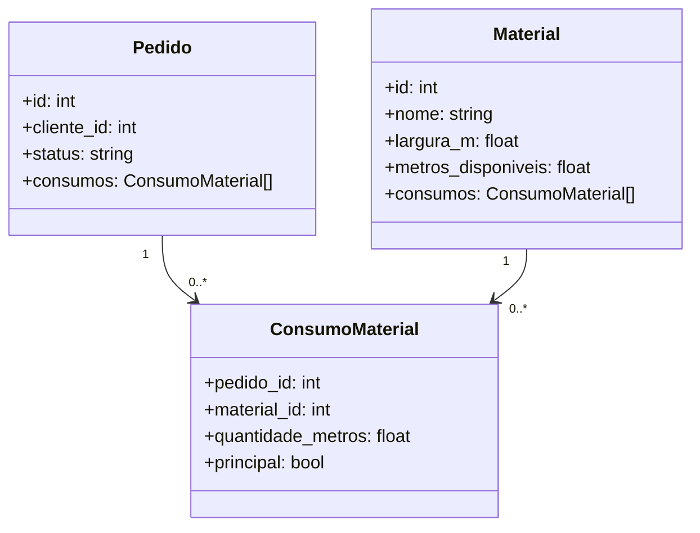
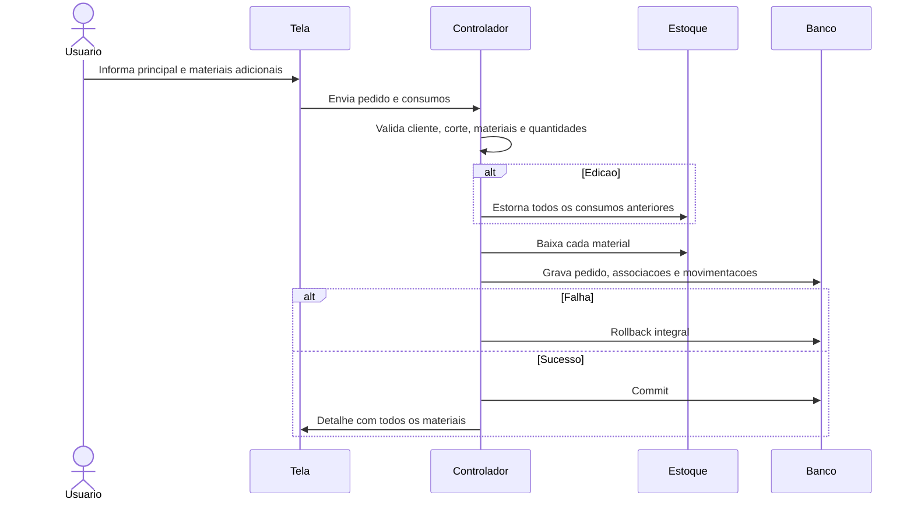

# UML — Modelo final de pedidos e materiais

**Equipe:** Breno Tales de Oliveira Leite (RA: 2840482423029) — Daniel Fredi Soares Pereira (RA: 2840482421054) 
**Atualização:** 15/11/2026

## 1. Classes do relacionamento N:N

A classe associativa implementa a relação N:N e registra o consumo por pedido e material. A coleção pode estar vazia em pedidos antigos não identificados; pedidos novos possuem pelo menos o material principal.

## 2. Fluxo de salvamento

O envio de notificações continua ligado à transição de status. A inclusão de materiais não dispara mensagens.

Veja o [DER final](der.md), a [implementação](../models/consumo_material.py) e os [testes](../tests/test_consumo_material.py). A [UML E3](E3-uml.md) continua disponível como artefato histórico.
